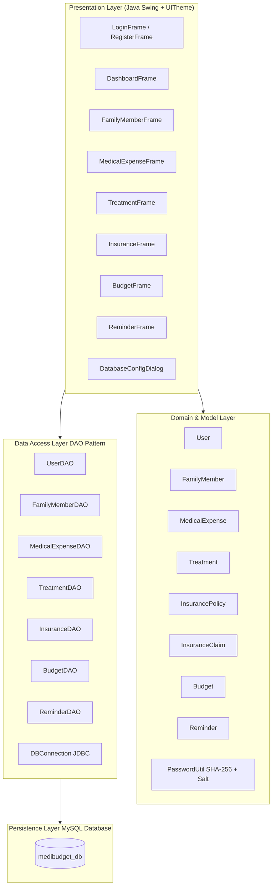
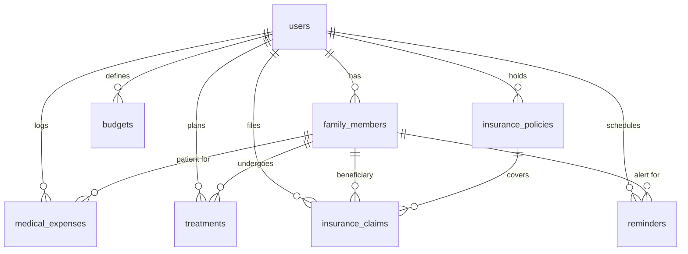

# MediBudget — Medical Expense Planner for Household Financial Protection

[](https://www.oracle.com/java/)
[](https://www.mysql.com/)
[](https://en.wikipedia.org/wiki/Data_access_object)
[](https://en.wikipedia.org/wiki/Salt_(cryptography))
[](LICENSE)

> A production-grade Java Swing desktop application engineered to help modern households systematically monitor healthcare expenditures, manage family medical treatments, track health insurance policies and reimbursement claims, and prevent catastrophic out-of-pocket medical debt.

---

## 📑 Table of Contents

- [Overview & Problem Statement](#-overview--problem-statement)
- [Key Features & Modules](#-key-features--modules)
- [System Architecture](#-system-architecture)
- [Database Schema & ER Overview](#-database-schema--er-overview)
- [Project Directory Structure](#-project-directory-structure)
- [Technology Stack](#-technology-stack)
- [Quick Start Guide](#-quick-start-guide)
  - [Prerequisites](#prerequisites)
  - [Database Configuration](#database-configuration)
  - [Compiling & Running](#compiling--running)
- [Security & Data Protection](#-security--data-protection)
- [Automated Verification & Tests](#-automated-verification--tests)
- [Demonstration & Presentation Walkthrough](#-demonstration--presentation-walkthrough)
- [Author & Acknowledgments](#-author--acknowledgments)

---

## 💡 Overview & Problem Statement

Healthcare expenditures represent one of the fastest-growing and least predictable components of household budgets. Sudden hospitalizations, recurring chronic illness medications, surgical procedures, and convoluted insurance claim reimbursements frequently strain family savings.

**MediBudget** solves this by providing households with an integrated financial and clinical management hub:
- **Financial Predictability**: Real-time monthly spending caps with threshold warnings before budget overruns occur.
- **Unified Family Records**: Centralized medical profiles for dependents, parents, and children with blood group and allergy notes.
- **End-to-End Insurance Lifecycle**: Trace policies, premium deadlines, and filed claims through approval and settlement.
- **Treatment Cost Projections**: Log surgical and dental estimates against actual bills.

---

## 🏥 Key Features & Modules

### 1. 🛡️ User Authentication & Multi-Tenant Isolation
- Cryptographic password hashing using **SHA-256** combined with a unique **128-bit cryptographically secure random salt** per user.
- Multi-tenant architecture ensuring users can strictly view and edit only their own household's medical records.
- Input validation preventing duplicate usernames and weak credentials.

### 2. 📊 Executive Healthcare & Financial Dashboard
- **Live KPI Metrics**: Real-time counters for cumulative healthcare spend, current month spend, remaining monthly budget cap, registered family members, active treatments, and pending insurance claims.
- **Dynamic Budget Gauge**: Interactive progress bar with color-coded status badges:
  - 🟢 `Within Safe Limits`
  - 🟡 `Warning: Threshold Exceeded`
  - 🔴 `Over Budget`
- **Upcoming Reminders Widget**: Pinned list of pending medication refills and doctor consultations with a 1-click **"Mark Done ✓"** toggle.
- **Central Navigation Hub**: Instant access to all 6 specialized management modules.

### 3. 👨‍👩‍👧‍👦 Family Member Management
- Profile family members with relationship labels (`Self`, `Spouse`, `Father`, `Mother`, `Child`, `Other`), age, gender, blood group, and clinical notes.
- Medical-fintech styled interactive `JTable` with instant search and CRUD capabilities.

### 4. 💊 Medical Expense Tracker
- Categorized expense logging:
  - `Doctor Consultation`, `Pharmacy / Medications`, `Diagnostic Tests & Scans`, `Hospitalization`, `Surgery / Procedures`, `Dental Care`, `Optical / Vision`, `Emergency Care`
- Patient linkage directly tied to registered family members.
- Multi-payment tracking (`Cash`, `UPI / GPay / PhonePe`, `Debit / Credit Card`, `Net Banking`, `Health Insurance`).
- Real-time aggregation of total and monthly expenditures.

### 5. 🏥 Treatment & Procedure Planning
- Manage scheduled and ongoing medical therapies (e.g., knee surgeries, dental implants, chemotherapy, physiotherapy).
- Track hospital/clinic name, attending physician, estimated procedure costs, start date, and status (`Planned`, `Ongoing`, `Completed`, `Cancelled`).

### 6. 🛡️ Health Insurance Policies & Claims Workflow
- **Policy Management**: Maintain details of insurance providers (e.g., Star Health, HDFC ERGO, Care Health), policy numbers, policy types (`Family Floater`, `Individual Health`, `Critical Illness`, `Senior Citizen`), sum insured, annual premiums, and renewal dates.
- **Reimbursement Workflow**: File claims linked to specific policies and patients, track claimed vs. settled amounts, and transition statuses (`Submitted` ➔ `Under Review` ➔ `Approved` ➔ `Rejected` ➔ `Settled`).

### 7. 🎯 Household Medical Budget Planner
- Establish customizable monthly expenditure limits per month and year.
- Configurable alert threshold percentage slider (e.g., alert at 80% utilization).
- Automatic calculation of actual expenses versus budgeted ceiling.

### 8. ⏰ Healthcare Reminders & Alerts
- Schedule time-sensitive alerts for medication refills, follow-up consultations, lab diagnostics, vaccinations, and policy renewals.
- Direct resolution from the dashboard or the dedicated reminders panel.

### 9. ⚙️ Automatic Self-Configuring Database Engine
- Built-in graphical **"⚙ DB Settings"** dialog on the login screen.
- Automatically tests connectivity and executes `schema.sql` to initialize `medibudget_db` and all 8 relational tables with zero manual SQL commands required.

---

## 🏛️ System Architecture



---

## 🗄️ Database Schema & ER Overview



The database `medibudget_db` consists of 8 normalized relational tables:
1. `users`: Credentials, salt, user profile metadata.
2. `family_members`: Dependents with age, relationship, blood group.
3. `budgets`: Monthly financial limits and threshold percentage per household.
4. `medical_expenses`: Categorized expense records linked to family members.
5. `treatments`: Medical procedures, estimated costs, hospitals, and doctors.
6. `insurance_policies`: Policy coverage, providers, premiums, and validity.
7. `insurance_claims`: Insurance claims linked to policies with settlement tracking.
8. `reminders`: Health and policy reminder alerts.

---

## 📂 Project Directory Structure

```plaintext
MediBudget/
├── .gitignore                      # Git exclusion rules (compiled bytecode, secrets)
├── compile.bat                     # Quick-compile batch script for Windows
├── db.properties.example           # Template for MySQL credentials
├── README.md                       # Comprehensive project documentation
├── run.bat                         # One-click application launcher for Windows
├── schema.sql                      # Complete database creation script
│
├── lib/
│   └── mysql-connector-j.jar       # MySQL JDBC driver library
│
└── [Source Code Files]
    ├── Main.java                   # Application bootstrap and entry point
    ├── DBConnection.java           # JDBC connection pool manager & auto-initializer
    ├── DatabaseConfigDialog.java   # In-app DB connection configuration modal
    ├── UITheme.java                # Medical-fintech design system & custom Swing styling
    ├── PasswordUtil.java           # SHA-256 password salting & hashing utility
    ├── TestMediBudget.java         # End-to-end automated test suite
    │
    ├── [Presentation Frames]
    │   ├── LoginFrame.java         # Secure authentication screen
    │   ├── RegisterFrame.java      # New user onboarding screen
    │   ├── DashboardFrame.java     # Central KPI & navigation dashboard
    │   ├── FamilyMemberFrame.java  # Family members management module
    │   ├── MedicalExpenseFrame.java# Medical expenditures tracking module
    │   ├── TreatmentFrame.java     # Treatment planning & procedure tracker
    │   ├── InsuranceFrame.java     # Insurance policies & claims manager
    │   ├── BudgetFrame.java        # Monthly budget planner & thresholds
    │   └── ReminderFrame.java      # Healthcare reminders & alerts
    │
    ├── [Data Access Objects]
    │   ├── UserDAO.java
    │   ├── FamilyMemberDAO.java
    │   ├── MedicalExpenseDAO.java
    │   ├── TreatmentDAO.java
    │   ├── InsuranceDAO.java
    │   ├── BudgetDAO.java
    │   └── ReminderDAO.java
    │
    └── [Domain Models]
        ├── User.java
        ├── FamilyMember.java
        ├── MedicalExpense.java
        ├── Treatment.java
        ├── InsurancePolicy.java
        ├── InsuranceClaim.java
        ├── Budget.java
        └── Reminder.java
```

---

## 🛠️ Technology Stack

| Component | Technology | Description |
| :--- | :--- | :--- |
| **Language** | Java 21 LTS (or 17+) | Core object-oriented language |
| **UI Framework** | Java Swing + AWT | Desktop GUI with customized components |
| **Design System** | `UITheme` Custom Palette | Medical Slate (`#0F172A`), Teal (`#0D9488`), Emerald (`#10B981`) |
| **Database** | MySQL Server 8.0+ | Relational database management system |
| **Driver** | MySQL Connector/J | JDBC 8.x database connector |
| **Security** | SHA-256 + 128-bit Salt | Cryptographic password hashing |
| **Architecture** | DAO Pattern | Decoupled business logic and persistence |

---

## 🚀 Quick Start Guide

### Prerequisites
1. **Java Development Kit (JDK)**: Java 17 or Java 21 LTS installed (`java -version`, `javac -version`).
2. **MySQL Server**: MySQL 8.0 or higher running locally or accessible via network.

---

### Database Configuration

You can configure the database using **either** of the following methods:

#### Method A: Automatic Setup via GUI (Recommended)
1. Launch the application (see running instructions below).
2. On the Login screen, click **"⚙ DB Settings"** at the bottom.
3. Enter your MySQL host, port, username, and password.
4. Click **"Test Connection"**, then click **"Save & Initialize DB"**.
5. The application will automatically create `medibudget_db` and all required tables.

#### Method B: Manual Configuration (`db.properties`)
Copy `db.properties.example` to `db.properties` in the project root:
```properties
db.host=localhost
db.port=3306
db.name=medibudget_db
db.user=root
db.password=YOUR_MYSQL_PASSWORD_HERE
```
Optionally, execute `schema.sql` manually in MySQL Workbench or terminal:
```bash
mysql -u root -p < schema.sql
```

---

### Compiling & Running

#### Option 1: Using Windows Batch Scripts (Easiest)
- **Run the app**: Double-click `run.bat`
- **Recompile**: Double-click `compile.bat`

#### Option 2: Using Terminal / PowerShell

**Compile all files:**
```powershell
$files = (Get-ChildItem -Filter "*.java").FullName; javac -cp ".;lib\mysql-connector-j.jar" -d . $files
```

**Run Desktop Application:**
```powershell
java -cp ".;lib\mysql-connector-j.jar" MediBudget.Main
```

**Run Automated Verification Suite:**
```powershell
java -cp ".;lib\mysql-connector-j.jar" MediBudget.TestMediBudget
```

---

## 🔒 Security & Data Protection

- **No Plaintext Passwords**: Passwords are never stored in plaintext. They are salted with a cryptographically secure pseudo-random 16-byte value (`SecureRandom`) and hashed with `SHA-256`.
- **SQL Injection Immunization**: All queries and data modifications use JDBC `PreparedStatement` with parameterized inputs.
- **Tenant Isolation**: Every database query filters by `user_id`, guaranteeing zero cross-household data leakage.
- **Cascade Deletion**: When an account is removed, foreign key cascade constraints cleanly clean up associated records without orphaned data.

---

## 🧪 Automated Verification & Tests

MediBudget includes a built-in automated test suite (`TestMediBudget.java`) that verifies:
- Password salting and hashing consistency
- In-memory domain model instantiations
- Budget calculation logic and threshold triggers
- Database connectivity and schema validation

Run the test suite using:
```bash
java -cp ".;lib\mysql-connector-j.jar" MediBudget.TestMediBudget
```

---

## 📋 Demonstration & Presentation Walkthrough

Follow this 10-step sequence for college reviews, viva presentations, or live demonstrations:

1. **Database Setup**:
   - Open app ➔ Click **"⚙ DB Settings"** ➔ Show successful connection check.
2. **User Registration**:
   - Register a new account (e.g., `harsha`, Full Name: `Harsha Vardhan`).
   - Observe automatic navigation to Login screen upon success.
3. **Authentication**:
   - Log in with the registered credentials.
4. **Family Member Profiling**:
   - Open **"Family Members"** ➔ Add family members (Self, Mother, Father) with blood groups and clinical notes.
5. **Setting Monthly Budget**:
   - Open **"Budget Management"** ➔ Set a monthly cap (e.g., ₹25,000) and alert threshold (80%).
6. **Logging Medical Expenses**:
   - Open **"Medical Expenses"** ➔ Log doctor consultations and pharmacy bills across different family members.
7. **Dashboard Dynamic Updates**:
   - Return to the Dashboard ➔ Highlight how the **Budget Utilization Gauge**, **Remaining Budget**, and **Spend KPIs** dynamically reflect the new records.
8. **Treatment Planning**:
   - Open **"Treatment Plans"** ➔ Add a scheduled treatment (e.g., Physiotherapy at Apollo Hospital).
9. **Insurance Policy & Claims**:
   - Open **"Insurance & Claims"** ➔ Add a policy (e.g., Star Health) and file a reimbursement claim.
10. **Healthcare Reminders & Data Persistence**:
    - Add a reminder for medication refills ➔ Observe it appear on the Dashboard widget ➔ Click **"Mark Done ✓"**.
    - Close and relaunch the app with `run.bat` ➔ Log in to demonstrate persistent storage in MySQL.

---

## 📄 License

This project is licensed under the [MIT License](LICENSE).

---

## 👨‍💻 Author

**Harsha Vardhan**
- GitHub: [@01harsha2006](https://github.com/01harsha2006)
- Repository: [MediBudget](https://github.com/01harsha2006/MediBudget.git)
